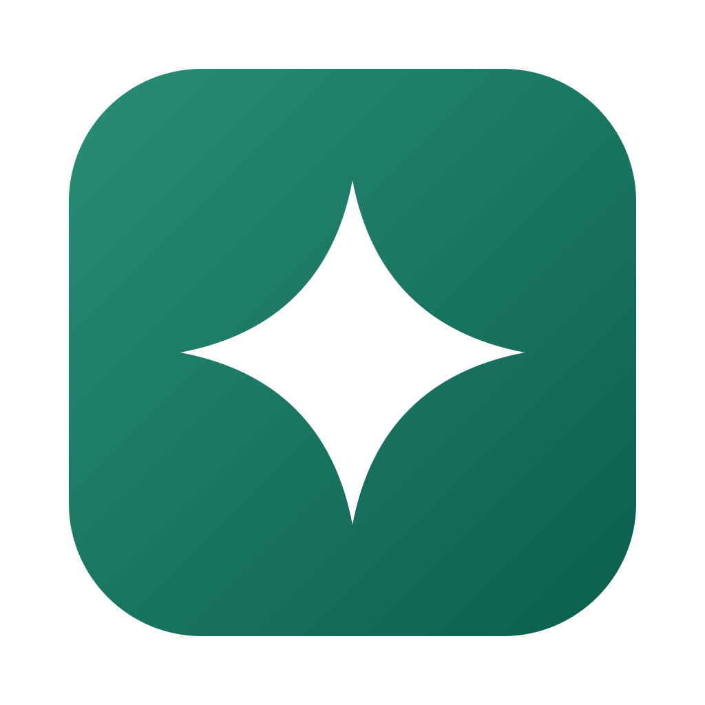

<p align="center">
  
</p>

<h1 align="center">Microlight</h1>

<p align="center">A native desktop app for AI chat and agents that work in your project.</p>

<p align="center">
  <a href="#quick-start">Quick Start</a>
  · <a href="docs/project.md">Project Docs (Chinese)</a>
  · <a href="docs/project.md#ci-与发布">Build and Release</a>
</p>

Microlight runs on macOS, Windows, and Linux. Connect it to an OpenAI-compatible model provider, keep conversations and drafts on your device, and control how the agent accesses files, runs commands, and uses the network.

## Features

- **Model switching.** Configure multiple providers and switch providers or models from the chat.
- **Rich conversations.** Paste images and files, read streamed replies with Markdown and LaTeX, and keep alternate replies in the same conversation when you edit a message or regenerate a response.
- **Workspace tools.** Let the agent read and edit files, run commands, use Skills, and connect to MCP servers. Review tool calls and file changes in the chat.
- **Session recovery.** Restore conversations, drafts, and pending questions after restarting. Long conversations can automatically summarize earlier turns to stay within the model's context budget.

## Quick Start

Install with Go 1.27.3 or later, then launch Microlight from your terminal.

**macOS and Linux**

```sh
CGO_ENABLED=0 go install github.com/ggdream/microlight@latest
microlight
```

**Windows (PowerShell)**

```powershell
$env:CGO_ENABLED = '0'
go install github.com/ggdream/microlight@latest
microlight.exe
```

> If double-clicking `microlight.exe` opens a console window, rerun the install command with `-ldflags="-H=windowsgui"` after `go install`.

If your terminal can't find the executable, add the directory returned by `go env GOBIN` to your `PATH`, or run the executable directly from that directory. If `GOBIN` is empty, look in the `bin` directory under your Go workspace (`go env GOPATH`).

Open **Settings → Model** and enter your provider's Base URL, Model ID, and API key. Select **Test Connection**, then **Save Settings**. To send images, choose a model that supports image input.

Microlight stores conversation history in a local SQLite database. Model requests go to your selected provider, and MCP tool calls can communicate with the servers you configure. [Local data and model requests (Chinese)](docs/project.md#本地数据与模型请求)

## Development

Microlight is built with Go, MyGo native UI, and Eino ADK. The project docs cover running from source, platform packaging, session storage, tool permissions, A2UI, and CI. [Project documentation (Chinese)](docs/project.md)

## License

Microlight is licensed under the [Apache License 2.0](LICENSE). Bundled third-party materials retain their respective licenses.
